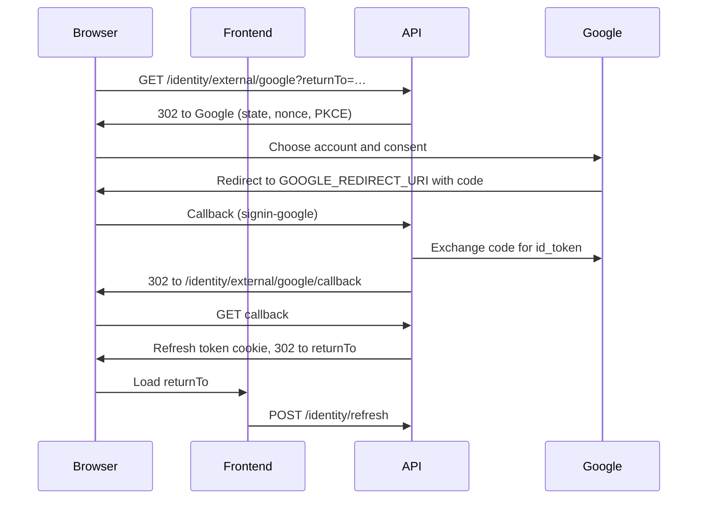

# Google sign-in

Users can sign in to BitFinance with their Google account as well as with an
email and password. Google is an OpenID Connect provider: the backend runs the
authorization code flow, validates Google's `id_token`, and then starts the
same session a password login starts, a refresh token in an `HttpOnly` cookie.
The frontend never sees a Google token.

Google sign-in is optional. It is turned on by `GOOGLE_CLIENT_ID`; with it
empty, the API serves no Google endpoints and the frontend shows no Google
button.

## How a sign-in works



1. **Continue with Google** on the sign-in or sign-up page is a link to
   `GET /api/v1/identity/external/google?returnTo=<path>`.
2. The API redirects to Google with the `openid`, `email` and `profile`
   scopes and `prompt=select_account`. The ASP.NET OpenID Connect handler adds
   `state`, a nonce and a PKCE challenge, and keeps their correlation in
   short-lived cookies.
3. Google redirects back to `GOOGLE_REDIRECT_URI`
   (`/api/v1/identity/external/google/signin-google`). The handler checks
   `state`, exchanges the code with the client secret and PKCE verifier, and
   validates the `id_token`: signature against Google's published keys, `iss`,
   `aud`, expiry and nonce.
4. The handler stores the Google identity in the temporary
   `Identity.External` cookie and redirects to
   `/api/v1/identity/external/google/callback`, which reads it, deletes the
   cookie and resolves the local user (see below).
5. On success the callback sets the refresh token cookie and redirects to
   `returnTo`. The frontend starts as it does on any page load: it calls
   `/identity/refresh`, gets an access token and loads `/identity/me`. A user
   without an organization goes on to create one.

`returnTo` must be a local path (it starts with `/`, not `//`, and has no
backslash); anything else becomes `/dashboard`. When the sign-in fails, or the
user cancels on Google's page, the browser lands on `/auth/sign-in` with a
`googleError` code that the page shows as a message.

## Accounts

The Google account is identified by its subject ID (`sub`), never by its
email. The link is stored in ASP.NET Identity's `AspNetUserLogins` table with
the login provider `Google` and the `sub` as the provider key.

| Situation | Result |
|---|---|
| The `sub` is linked to a user | That user is signed in. |
| No user has the `sub` or the email | A user is created from the Google profile, with no password, and linked. |
| No user has the `sub`, but one has the email | Refused with `email-in-use`. |
| Google says the email is not verified | Refused with `email-not-verified`. |
| The user is locked out | Refused with `locked-out`. |

A Google sign-in never links to an existing account by email. Registering
with a password does not confirm the email, so linking by email would let
whoever registered an address first keep a password into the account of the
person who owns it. Instead, a user who already has a password links Google
from their account settings.

### Linking and unlinking

**Account → Google account** shows whether Google is linked.

- **Link** opens `GET /api/v1/identity/external/google/link`. This is a
  browser navigation, which carries no access token, so the API identifies
  the user by the refresh token cookie, stores the user ID in the encrypted
  OpenID Connect state, and runs the same Google flow. After it, the browser
  returns to `/account/settings` with `google=linked`, or with `googleError`
  set to `already-linked` (another Google account is linked to this user),
  `linked-to-another-account` (this Google account belongs to another user)
  or `failed`.
- **Unlink** calls `DELETE /api/v1/identity/external/google`. It is refused
  for a user without a password, who would have no way left to sign in.
  Users created by Google sign-in have no password, so they keep Google.

`GET /api/v1/identity/me` returns `hasPassword` and `hasGoogleLogin` for the
account page.

## Endpoints

| Endpoint | Auth | Purpose |
|---|---|---|
| `GET /api/v1/identity/external/providers` | None | `{ "providers": ["google"] }` when Google is configured, `[]` otherwise |
| `GET /api/v1/identity/external/google?returnTo=` | None | Starts a Google sign-in |
| `GET /api/v1/identity/external/google/link?returnTo=` | Refresh token cookie | Starts linking Google to the signed-in user |
| `GET /api/v1/identity/external/google/signin-google` | Google redirect | Handled by the OpenID Connect handler |
| `GET /api/v1/identity/external/google/callback` | `Identity.External` cookie | Signs in or links, then redirects to the frontend |
| `DELETE /api/v1/identity/external/google` | Access token | Unlinks Google |

## Set up Google Cloud

The OAuth client is created once and does not need to be renewed.

1. In the [Google Cloud console](https://console.cloud.google.com/), create a
   project for BitFinance, or pick an existing one.
2. Open **Google Auth Platform → Branding** (the OAuth consent screen) and
   fill in the app name, support email and developer contact. Choose the
   **External** audience.
3. Under **Data access**, add the `openid`, `.../auth/userinfo.email` and
   `.../auth/userinfo.profile` scopes. They are non-sensitive, so Google does
   not require app verification for them.
4. Under **Audience**, click **Publish app** to move it from *Testing* to *In
   production*. In *Testing*, only listed test users can sign in.
5. Under **Clients**, create an OAuth client of type **Web application** with
   these **Authorized redirect URIs**:
   - `http://localhost:8080/api/v1/identity/external/google/signin-google`
     for local development;
   - `https://<production host>/api/v1/identity/external/google/signin-google`
     for production.

   No JavaScript origins are needed: the browser never calls Google from
   script.
6. Copy the client ID and the client secret. The console shows the secret
   only when it is created; if it is lost, add a new secret to the client.

Google deletes OAuth clients that go unused for about six months, after
notifying the project owners. Any sign-in counts as use.

Showing the BitFinance logo on Google's consent screen needs brand
verification: the production domain verified in Google Search Console, and
home page and privacy policy links in **Branding**.

## Configure BitFinance

| Variable | Setting | Value |
|---|---|---|
| `GOOGLE_CLIENT_ID` | `GoogleAuth:ClientId` | The OAuth client ID. Empty turns Google sign-in off. |
| `GOOGLE_CLIENT_SECRET` | `GoogleAuth:ClientSecret` | The OAuth client secret. |
| `GOOGLE_REDIRECT_URI` | `GoogleAuth:RedirectUri` | One of the authorized redirect URIs, exactly as registered. |
| | `GoogleAuth:FrontendBaseUrl` | Where the API sends the browser afterwards. Empty means the API's own origin. |

When `GoogleAuth:ClientId` is set, the API refuses to start without a client
secret and an absolute redirect URI.

- **Production**: set the three `GOOGLE_*` variables in the backend's `.env`;
  `docker-compose.prod.yml` passes them to the API. The frontend and the API
  share an origin, so `FrontendBaseUrl` stays empty and redirects are
  relative.
- **Local development**: set `GOOGLE_CLIENT_ID` and `GOOGLE_CLIENT_SECRET` in
  `apps/backend/.env`. The redirect URI defaults to the localhost one above,
  and `FrontendBaseUrl` is `http://localhost:5174`, in both
  `appsettings.Development.json` and `docker-compose.override.yml`. To run the
  API outside Docker, put the settings in user secrets:

  ```sh
  cd apps/backend/src/BitFinance.API
  dotnet user-secrets set "GoogleAuth:ClientId" "<client id>"
  dotnet user-secrets set "GoogleAuth:ClientSecret" "<client secret>"
  ```

The redirect URI the API sends to Google is `GOOGLE_REDIRECT_URI` itself, not
one built from the request, so it does not depend on the proxy's forwarded
headers. The proxy must route `/api/v1/identity/external/google/signin-google`
to the API like any other `/api` path.

## Limitations

- The OpenID Connect state and the `Identity.External` cookie are encrypted
  with ASP.NET Data Protection keys, which are not persisted. A sign-in that
  is in progress while the API restarts fails, and the user starts it again.
  Running more than one API instance would require persisting the keys.
- There is no way to set a password, so users created by Google sign-in can
  only sign in with Google, and the MCP server's agent account must keep
  using a password.
- The Google profile picture is not imported as the avatar.
